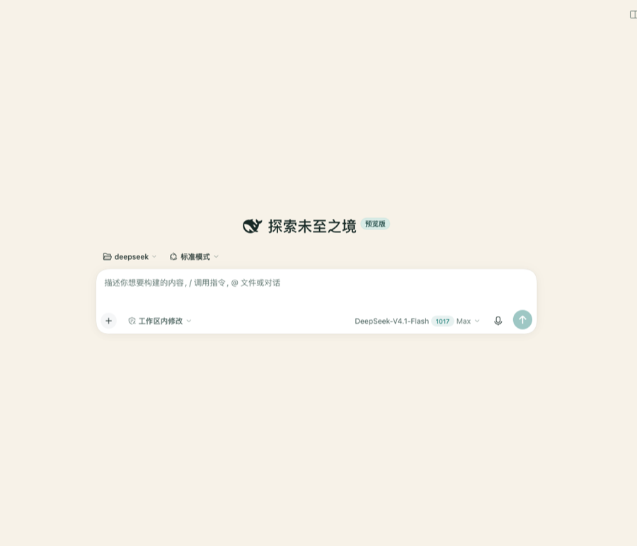
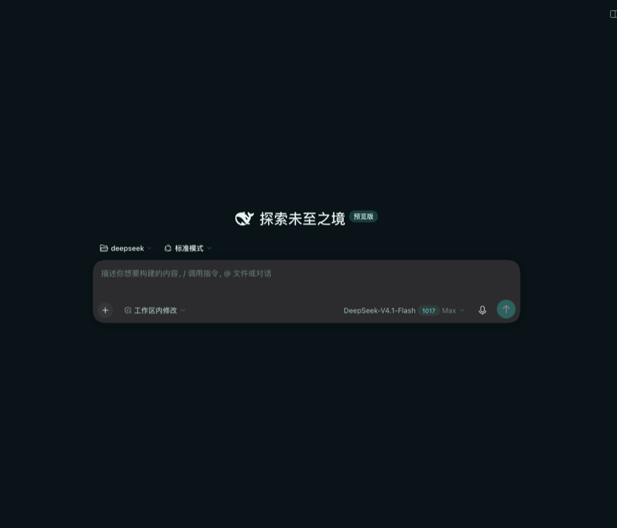

# Tide & Timber · 潮汐木色

一套给 DeepSeek Harness Web GUI 的**海岸线配色主题**：白天的「海盐晨雾」与夜里的「潮汐夜航」，都只通过官方 `ThemeRuntime` 的 `--dsw-alias-*` token 层叠加，不注入壁纸、不改布局、不劫持 DOM。

| Light — Salt & Timber | Dark — Twilight Cove |
| --- | --- |
|  |  |

> 2026-10-20 已在本机 `~/.dsh/profiles/web` 通过 profile patch + 符号链接热挂载，并用 headless Chromium 做了 light/dark 双模式计算样式与截图验证（详见 `dsh-daily-learning/2026-10-20.md` §4）。

- **Light — Salt & Timber**：暖象牙沙、海玻璃青、浮木墨色。主按钮是深海青，选中/链接是潮水绿。
- **Dark — Twilight Cove**：落潮后的深蓝绿、月光海玻璃、暖铜色状态点。整体低饱和、长时间阅读不刺眼。
- **自适应**：跟随 DSH 自带的 浅色 / 深色 / 跟随系统 设置，不需要另设开关。
- **可热插拔**：主题注册在 `ctx.effect` 内，禁用插件或热重载会精确撤回这一层 token。

## 安装

需要 DeepSeek Harness **0.2.1-rc.2** 及以上（`dsh-client-ui-theme` 的第三方主题入口在该版本提供）。

```sh
# 直接从仓库安装（当前可用）
dsh plugin --profile web add github:zys2026/dsh-theme-tide
```

装完重启 dsh（或在插件管理器里重载），主题会跟随 DSH 自带的「浅色 / 深色 / 跟随系统」设置自动切换，不需要额外开关。

**卸载 / 临时停用**：

```sh
dsh plugin --profile web remove dsh-theme-tide   # 卸载
```

或在插件管理器里把 `dsh-theme-tide` 设为禁用——主题注册在 `ctx.effect` 内，禁用会精确撤回这一层 token，不会残留。

**要求**：主题只通过官方 `--dsw-alias-*` token 覆盖上色，不改布局、不注入壁纸、不劫持 DOM；因此 DSH 升级若增删 token，未覆盖的新 token 会回落到内置默认色，不会破坏界面。

## 设计要点

| 项 | 值 |
| --- | --- |
| 扩展点 | `ctx.theme.overrideTokens(source, tokens)`（`dsh-client-ui-theme` 官方第三方主题入口） |
| 覆盖范围 | 0.2.1-rc.2 声明的全部 **107 个 `--dsw-alias-*`** token，每个都提供 light/dark 一对值 |
| 运行时依赖 | 无；`client.js` 是零依赖 IIFE，不需要 React、three.js 或打包器 |
| 持久化 | 不写设置、不写 localStorage；主题随插件的启用/禁用生效 |
| Host 半侧 | 空（只用于让 Loader 发现 `./client`） |

## 可验证质量（2026-10-20 审计）

`tools/audit.mjs` 会对照官方 token 契约做覆盖率检查，并对 21 组关键「文字/背景」和「图标/背景」组合计算 WCAG 2.x 对比度：

```sh
node dsh-theme-tide/tools/audit.mjs                 # 控制台表格
node dsh-theme-tide/tools/audit.mjs --json          # 机器可读
node dsh-theme-tide/tools/audit.mjs --write-preview # 写入 previews/audit.md
```

当前结果（light 与 dark 两套）：

- **覆盖率 107/107**：与 `dsh-client-ui-theme@0.2.1-rc.2` 的 alias 清单完全一致（含 `onboarding-checkbox-border`、`settings-card-stroke` 两个边角 token）。
- **必需的 21 组配对全部达到 WCAG AA**（正文/次级/三级/说明文字、链接、代码块、Toast、主按钮、状态色、菜单图标等）。
- 审计还发现并修掉了 3 个真实问题：light 的 `label-tertiary`（4.31→4.78）、`label-caption`（3.06→4.56）、dark 的 `state-warn-label` 与 `state-warn-tertiary` 配色错位（1.36→9.35）。
- `border-l3` / `scrollbar-bg-l1` 与背景的对比度低于 3:1 属**刻意的低对比装饰**（与官方内置主题同量级），审计标记为 advisory，不阻断。

完整报告：[previews/audit.md](previews/audit.md)。

## 安装

### 方式 A：作为 bundle 安装（推荐，持久）

```sh
dsh plugin --profile web add link:/Users/ys/Documents/deepseek/dsh-theme-tide
```

然后重启 DSH（或让插件管理器在 HMR 开启时热挂载）。插件的 `dsh.bundle.patch` 会插入 `dsh-theme-tide` 行，`dsh.client.immediately` 让它在页面启动时立即应用。

### 方式 B：运行中热挂载（本次会话采用）

1. 把包链接进 profile：
   `ln -s /Users/ys/Documents/deepseek/dsh-theme-tide ~/.dsh/profiles/web/node_modules/@local/dsh-theme-tide`
2. 在 `~/.dsh/profiles/web/cordis.patch.yml` 追加：

   ```yaml
   - insert:
       - id: dsh-theme-tide
         name: '@local/dsh-theme-tide'
         config: {}
   ```

3. `dsh-hmr` 监听 profile patch 变化，会重组合成并热挂载；页面无需重启 Host。
4. 若页面没有自动应用，刷新一次页面即可；Host 重启后该行依然存在。

## 开发

```sh
node dsh-theme-tide/tools/build.mjs             # 生成 client.js
node --check dsh-theme-tide/client.js           # 语法检查
node dsh-theme-tide/tools/audit.mjs             # token 覆盖 + WCAG AA
node dsh-theme-tide/tools/audit.mjs --write-preview  # 更新 previews/audit.md
```

- `src/palette.mjs`：两份完整调色板（唯一需要改的颜色文件）
- `src/official-tokens.json`：0.2.1-rc.2 官方 alias token 契约快照（107 个）
- `src/client.template.js`：浏览器半侧 IIFE 模板
- `tools/build.mjs`：校验两份调色板 key 一致、全部为 `--dsw-alias-*`，注入模板生成 `client.js`
- `tools/audit.mjs`：覆盖率 + WCAG 2.x 对比度审计（零依赖，可复用为通用主题检查器）

## 卸载

删除 `~/.dsh/profiles/web/cordis.patch.yml` 里的 `dsh-theme-tide` insert 行，再删除 profile 的 `node_modules/@local/dsh-theme-tide` 链接即可；页面刷新后恢复默认配色。

## 兼容性

- 构建/验证环境：DSH `0.2.1-rc.2`（`dsh-client-ui-theme` 0.2.1-rc.2，`overrideTokens` 与 `ThemeTokenModes` 契约）。
- 第三方主题 id 属于进程内扩展；本主题刻意**不注册新 theme id**，而是叠加 token 层，因此与官方 Appearance 的 light/dark/system 完全兼容。
- 若未来 DSH 新增 alias token，未覆盖的 token 会回退到内置调色板；在 `src/palette.mjs` 补齐即可。

---

English: **Tide & Timber** is a dependency-free coastal light/dark theme for the DSH Web GUI. It registers a `ThemeRuntime.overrideTokens` layer covering every `--dsw-alias-*` token in 0.2.1-rc.2 (107 tokens, light+dark pairs), follows the built-in Appearance preference, and retracts cleanly when the plugin is disabled or hot-reloaded. No wallpaper, no DOM overrides, no settings writes.
